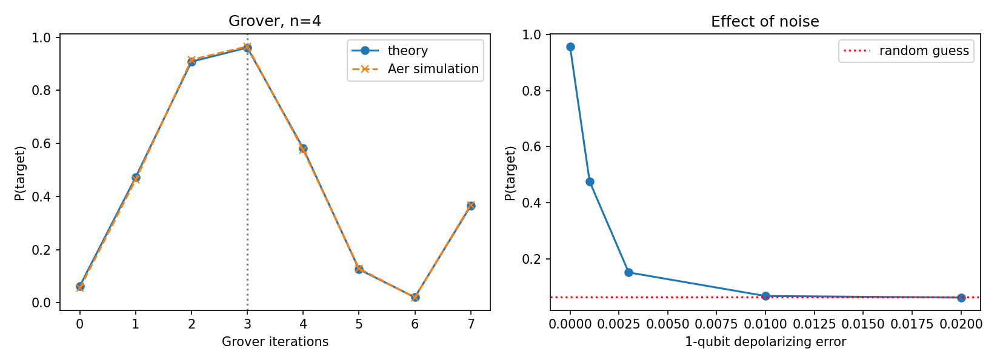
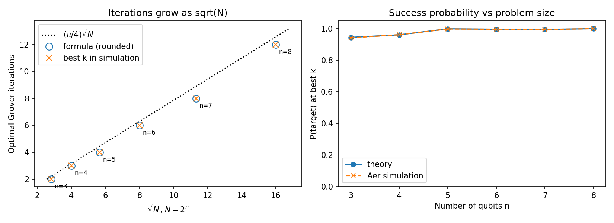
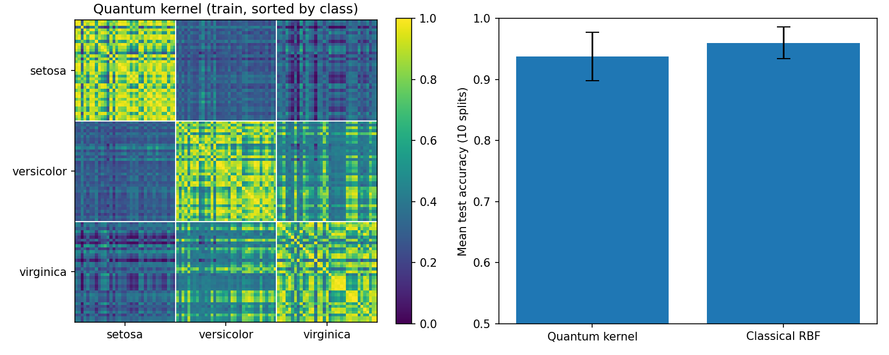

# Quantum Computing with Qiskit: Grover's Search and a Quantum-Kernel Classifier

Two small, self-contained projects that explore a core quantum algorithm and a quantum machine learning
method, with every result checked against theory or a classical baseline.

| Project | File | Question it answers |
|---|---|---|
| Grover's search | `grover.py` | Does my from-scratch implementation match theory, and how much noise can it survive? |
| Quantum-kernel SVM | `quantum_iris.py` | Can a 4-qubit feature map classify Iris as well as a classical RBF-SVM? |

The classifier extends my classical [IrisInsight](https://github.com/YOUR_USERNAME/IrisInsight) project by replacing the
classical kernel with one computed from quantum states.

---

## 1. Grover's search

### Method
- Search space of N = 2ⁿ items with one marked bitstring (default n = 4, target `1011`).
- **Oracle:** X gates on the target's 0-bits, a multi-controlled Z, then X gates again, which flips the sign of the target state only.
- **Diffuser:** H, X, multi-controlled Z, X, H, which reflects all amplitudes about their mean.
- Repeating oracle + diffuser rotates the state toward the target. The best iteration count is about (π/4)·√N.
- Run on Qiskit Aer (4096 shots) and compared with the closed form P(k) = sin²((2k+1)·θ), where sin θ = 1/√N.

### Results

- **Simulation matches theory.** For n = 4 the Aer curve overlaps the analytical curve at every iteration count (differences are within shot noise).
- **Optimum at k = 3 iterations** with success probability ≈ 0.96, against 1/16 ≈ 0.06 for a random guess.
- **Over-rotation is real.** More iterations is not better: success falls to ≈ 0.02 at k = 6 and rises again at k = 7. The amplitude oscillates, so the iteration count must be chosen correctly.
- **Noise is destructive.** With depolarizing noise (2-qubit error set to 10× the 1-qubit error) on the transpiled 182-gate circuit, success at the optimal k falls from 95.7% (noiseless) to 47.6% at 0.1% 1-qubit error, 15.1% at 0.3%, and 6.7% at 1%, which is the random-guess level (1/16 = 6.25%). Grover's circuit needs many entangling gates, so it is highly sensitive to gate error, which is why fault tolerance and error mitigation matter.

### Scaling study (n = 3 to 8)

`grover.py` also repeats the experiment for n = 3 to 8 qubits (search spaces of 8 to 256 items) and checks
that the best simulated iteration count agrees with the exact optimum round(π/(4θ) − ½), which approaches
(π/4)·√N for large N. Theory values:

| n | N | √N | optimal iterations | ideal success |
|---|---|---|---|---|
| 3 | 8 | 2.8 | 2 | 94.5% |
| 4 | 16 | 4.0 | 3 | 96.1% |
| 5 | 32 | 5.7 | 4 | 99.9% |
| 6 | 64 | 8.0 | 6 | 99.7% |
| 7 | 128 | 11.3 | 8 | 99.6% |
| 8 | 256 | 16.0 | 12 | 100.0% |

Making the search space 4× larger (two more qubits) only doubles the iterations needed. A classical search
needs about N/2 guesses on average, so this is the quadratic speed-up. The Aer simulation agrees: for every n from 3 to 8 the best simulated iteration count equals the formula, and the simulated success probability is within 0.003 of theory.

---

## 2. Quantum-kernel classifier on Iris

### Method
1. Load Iris (150 samples, 4 features, 3 classes) and make a stratified 70/30 train/test split; repeat over several random seeds.
2. Scale features to [0, 1] with a scaler fitted on the training data only.
3. **Feature map:** a feature value x becomes a rotation angle π·scale·x. Each sample becomes a 4-qubit state (one qubit per feature) using Hadamards, phase rotations, and CX-phase-CX blocks between every qubit pair, repeated `reps` times.
4. **Quantum kernel:** K(x, y) = |⟨φ(x)|φ(y)⟩|², the squared overlap of two encoded states.
5. **Model selection without touching the test set:** 5-fold cross-validation on the training part picks `reps` (1 or 2), `scale` (0.05 to 1.0) and the SVM's C. The classical RBF-SVM baseline gets the same treatment (C and γ).
6. Each chosen model is scored once on the held-out test set.
7. A NumPy statevector simulator of the same circuit is included, so the code runs without Qiskit. When Qiskit is installed, the script checks that both simulators agree (fidelity 1.0).

### Results

- **Accuracy (10 splits, CV-tuned):** quantum-kernel SVM about 94% ± 4, classical RBF-SVM about 96% ± 3. The two are within one standard deviation of each other.
- **The kernel learns the class structure.** Sorted by class, the kernel matrix shows three bright diagonal blocks: flowers of the same species have a high state overlap, flowers of different species have a low one. Setosa is almost fully separated from the other two, while versicolor and virginica overlap more. This is the same pair a classical classifier confuses.
- **Circuit design matters.** A deep feature map with the full [0, π] range gave only about 75% accuracy in a fixed-setting test: the encoded states become nearly orthogonal and the model overfits. Cross-validation consistently chose the smallest feature ranges, and usually a single repetition.

### Honest interpretation
- This shows the quantum kernel **works**, not that it is **better**. Iris is small and easy, and the kernel was simulated on a classical computer, so there is no speed-up or advantage here.
- Because hyperparameters are chosen by cross-validation on the training data only, the reported accuracy is not tuned on the test set.

---

## Run it
    python -m venv .venv && source .venv/bin/activate      # Windows: .venv\Scripts\activate
    pip install -r requirements.txt

    python grover.py --n 4 --target 1011          # writes grover_results.png
    python quantum_iris.py                        # writes quantum_iris_results.png
    python quantum_iris.py --backend numpy        # no Qiskit required
    python quantum_iris.py --reps 2 --scale 1.0   # fixed, over-expressive map (shows the failure case)
    python grover.py --skip-scaling               # skip the n=3..8 study (faster)

## Project structure
    grover.py            Grover oracle, diffuser, theory check, noise study, n=3..8 scaling study
    quantum_iris.py      Feature map, quantum kernel, CV-tuned SVM, classical baseline, self-test
    requirements.txt     qiskit, qiskit-aer, scikit-learn, matplotlib, numpy
    grover_results.png, grover_scaling.png, quantum_iris_results.png

## Possible extensions
- Estimate the kernel from finite shots and with hardware-style noise.
- Grover with several marked items, where the iteration count changes to (π/4)·√(N/M).
- Run the 3-qubit Grover circuit on real IBM Quantum hardware.
- Compare other feature maps and a variational quantum classifier.

## Tech
Python, Qiskit, Qiskit Aer, scikit-learn, NumPy, Matplotlib
